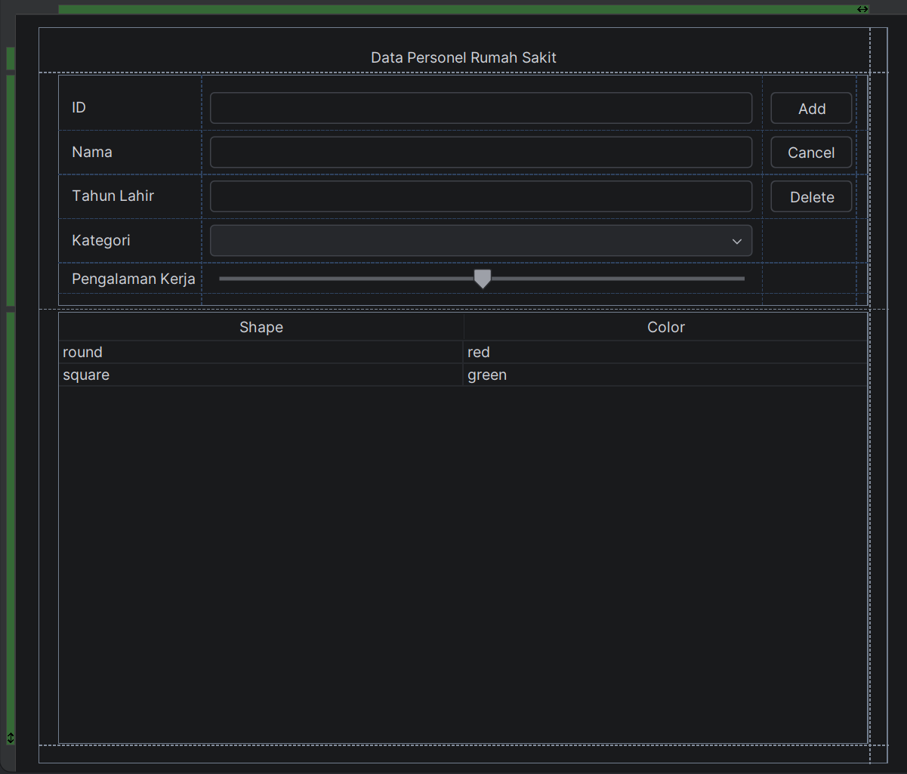
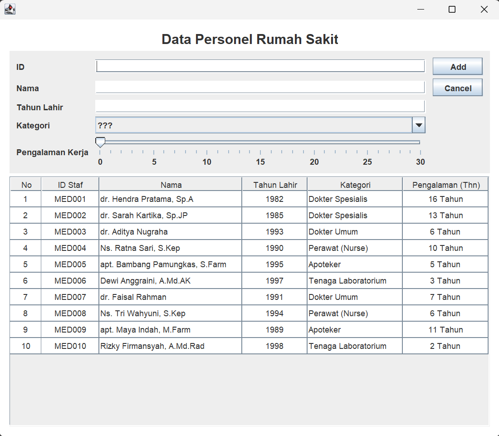
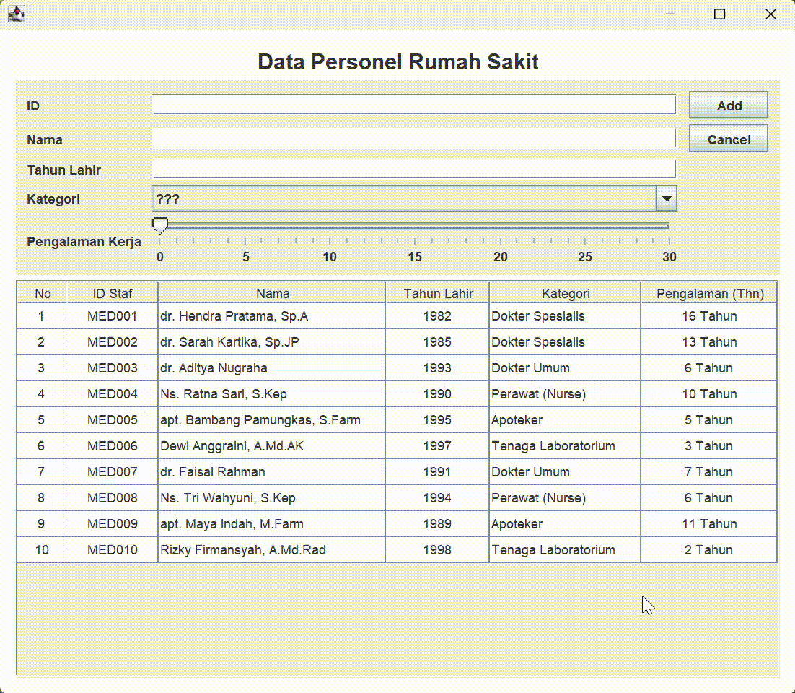
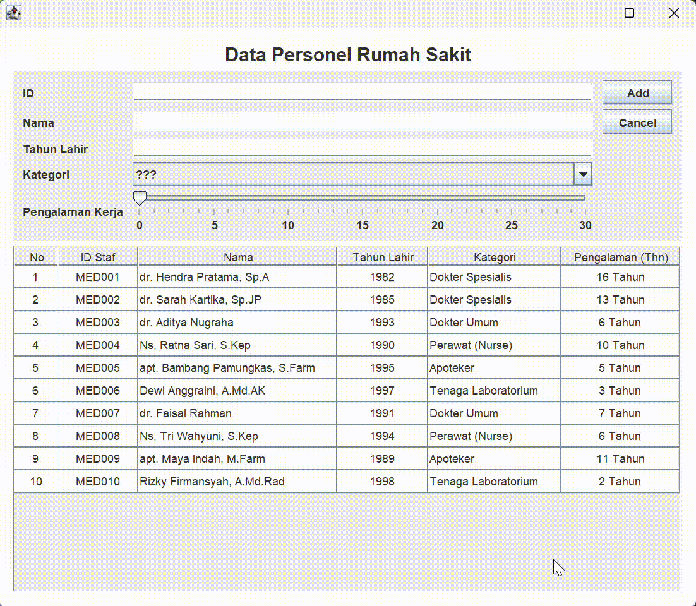
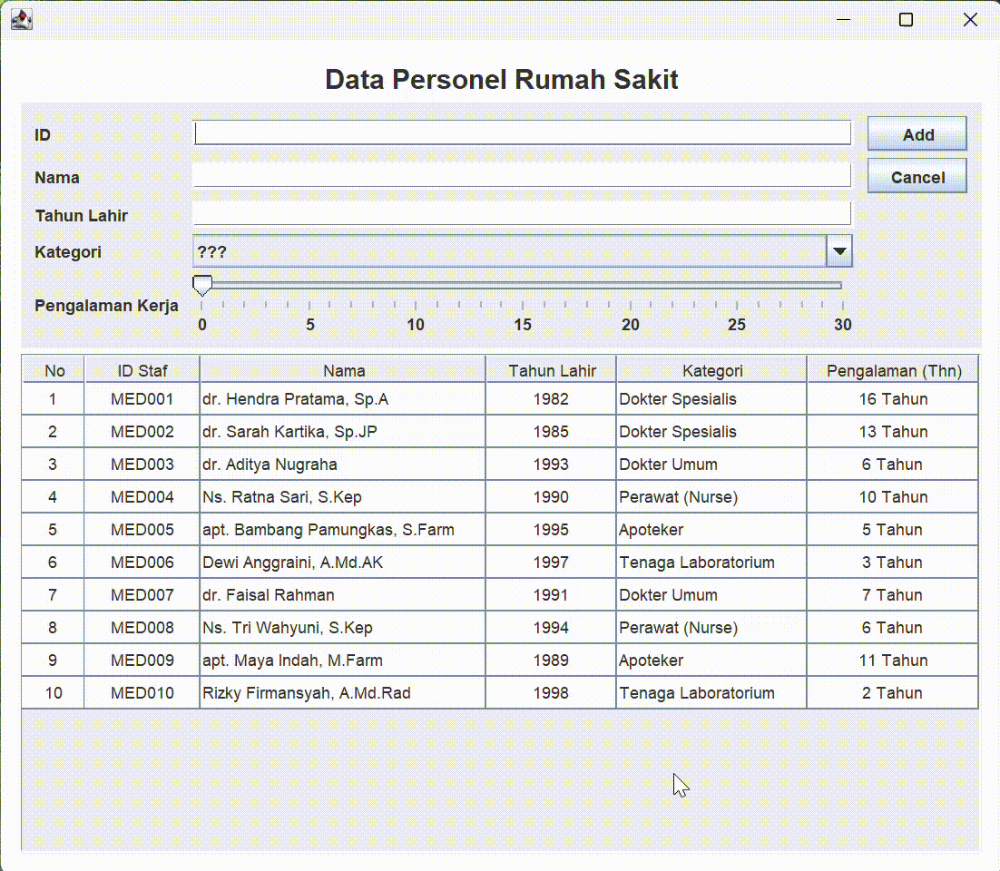
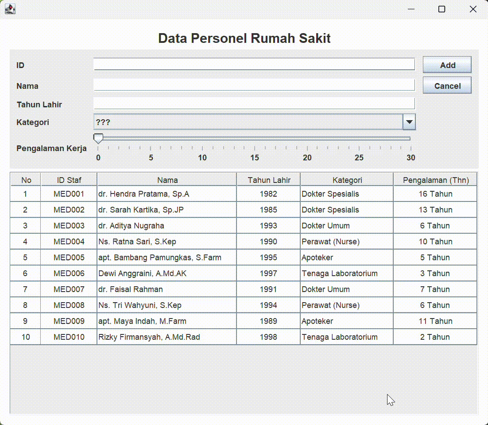
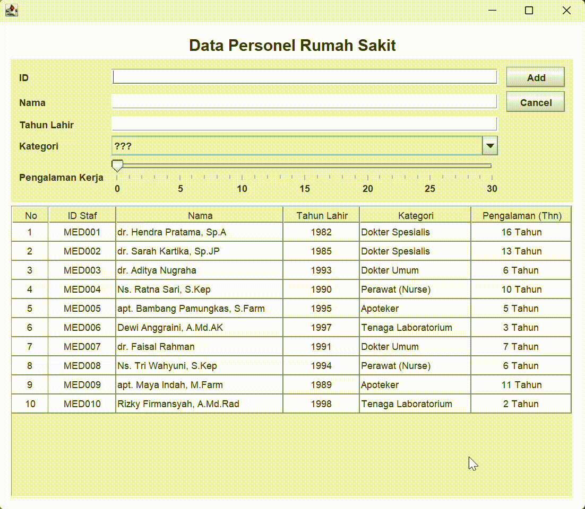
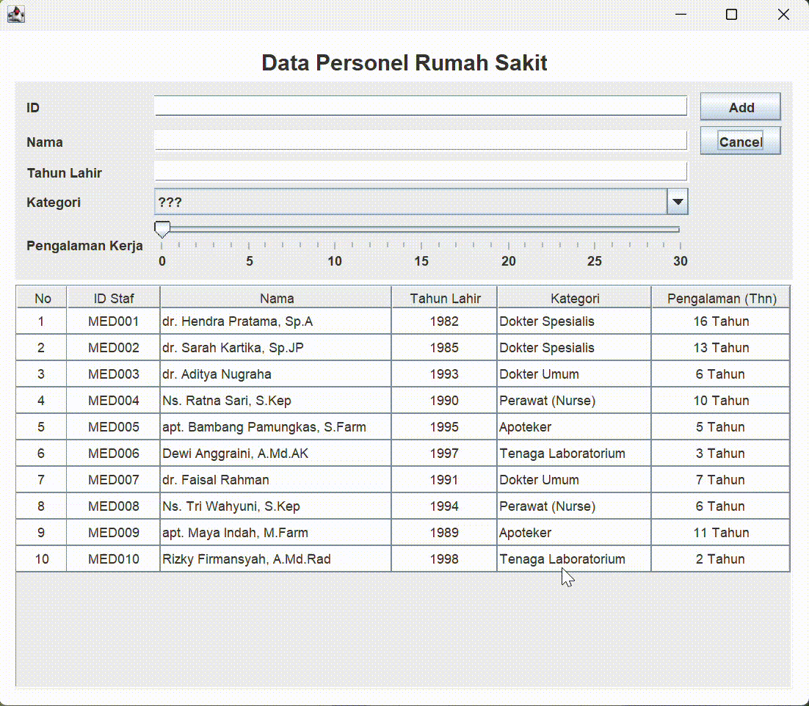
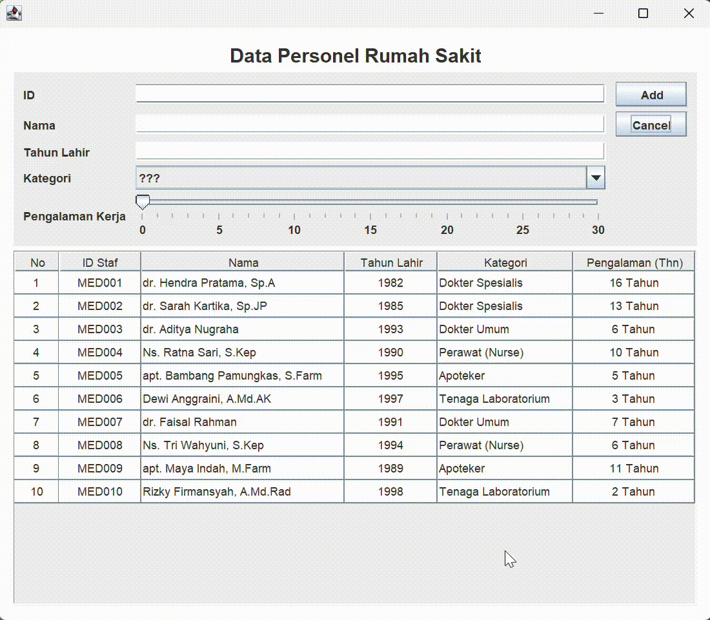
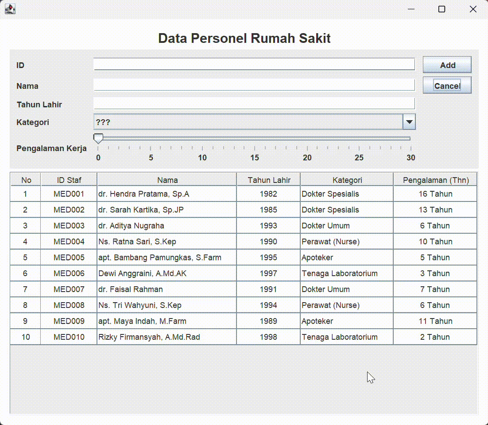

# Tugas Praktikum 4 - Java Swing GUI (PeopleData)

Mata Kuliah: **Desain dan Pemrograman Berorientasi Objek (DPBO)**  
Program Studi Ilmu Komputer, FPMIPA Universitas Pendidikan Indonesia  

---

## 📌 Janji
Saya **R Mohammad FIkry Mushoffa S** dengan NIM **2502049** mengerjakan Tugas Praktikum 4 dalam mata kuliah Desain dan Pemrograman Berorientasi Objek untuk keberkahan-Nya maka saya tidak melakukan kecurangan seperti yang telah dispesifikasikan. Aamiin.

---

## 📁 Struktur Folder
```text
TP4DPBO2526C2/
├── PeopleData/
│   └── src/
│       ├── Person.java
│       ├── PeopleMenu.java
│       └── PeopleMenu.form
├── Dokumentasi/
│   ├── GUI.png
│   ├── Read.png
│   ├── Add.gif
│   ├── Update.gif
│   ├── Delete.gif
│   ├── ErrorFieldKosong.gif
│   ├── ErrorIDDuplikat.gif
│   ├── ErrorKategoriKosong.gif
│   ├── ErrorRentangTahun.gif
│   └── ErrorTahunBukanAngka.gif
└── README.md
```

---

## 🩺 Desain dan Fungsi Program

Aplikasi **PeopleData** adalah program desktop berbasis GUI menggunakan **Java Swing** dengan tema **Data Personel Medis & Rumah Sakit (Healthcare & Hospital Personnel)**. Program ini menerapkan prinsip *Object-Oriented Programming* (OOP) serta menyediakan antarmuka visual yang interaktif untuk melakukan operasi **CRUD** (*Create, Read, Update, Delete*) secara lengkap.

### 1. Class `Person`
Class model entitas yang merepresentasikan satu individu tenaga medis/personel rumah sakit dengan atribut:
- `id` (`String`): Nomor identitas unik personel (contoh: `MED001`, `MED002`).
- `nama` (`String`): Nama lengkap beserta gelar (contoh: `dr. Hendra Pratama, Sp.A`).
- `tahunLahir` (`int`): Tahun kelahiran personel (contoh: `1985`, `1992`).
- `kategori` (`String`): Bidang profesi/kategori medis (`Dokter Spesialis`, `Dokter Umum`, `Perawat (Nurse)`, `Apoteker`, `Tenaga Laboratorium`).
- **`pengalamanKerja` (`int`)** *(Atribut Baru - Nilai Bonus +20)*: Lama pengalaman kerja dalam satuan tahun (0–30 tahun).

Method pada class `Person`:
- `Person()`: Default constructor.
- `Person(String id, String nama, int tahunLahir, String kategori, int pengalamanKerja)`: Constructor lengkap dengan parameter.
- Getter dan Setter untuk seluruh atribut.

### 2. Class `PeopleMenu extends JFrame`
Class utama yang mengelola tampilan grafis (GUI) dan logika controller event-driven aplikasi:
- **`mainPanel` (`JPanel`)**: Kontainer utama form aplikasi.
- **`titleLabel` (`JLabel`)**: Judul menu aplikasi dengan styling tebal (*Bold, size 20*).
- **`idField` (`JTextField`)**: Input ID personel.
- **`namaField` (`JTextField`)**: Input nama personel.
- **`tahunField` (`JTextField`)**: Input tahun kelahiran personel.
- **`kategoriComboBox` (`JComboBox<String>`)**: Pilihan drop-down kategori profesi.
- **`pengalamanSlider` (`JSlider`)**: Slider untuk menentukan lama pengalaman kerja dalam tahun (0–30 tahun).
- **`addUpdateButton` (`JButton`)**: Tombol ganda yang berfungsi sebagai *Add* (menambahkan) saat form kosong, dan berubah menjadi *Update* saat baris tabel dipilih.
- **`cancelButton` (`JButton`)**: Tombol untuk membatalkan operasi atau mengosongkan form input.
- **`deleteButton` (`JButton`)**: Tombol untuk menghapus baris data yang dipilih (disembunyikan saat mode tambah).
- **`personTable` (`JTable`)**: Tabel interaktif untuk menampilkan daftar personel.

**Method Utama dalam `PeopleMenu`:**
1. `main(String[] args)`: Entry point aplikasi untuk menginisialisasi ukuran jendela (750x650), posisi tengah layar (*center*), dan penutupan aplikasi (*EXIT_ON_CLOSE*).
2. `PeopleMenu()` (Constructor): Menyiapkan event listeners, mengisi data awal, mengatur model tabel, combo box, dan slider.
3. `populateList()`: Mengisi 10 data awal personel rumah sakit ke dalam `listPerson`.
4. `setTable()`: Membangun `DefaultTableModel` untuk menampilkan data dari `listPerson` ke `personTable`.
5. `isIdExists(String id, int excludeIndex)`: Memeriksa keunikan ID agar tidak terjadi duplikasi data.
6. `insertData()`: Memvalidasi input dan memasukkan data baru ke dalam `listPerson` serta merefresh tabel.
7. `updateData()`: Memvalidasi input dan memperbarui data personel yang sedang dipilih.
8. `deleteData()`: Menghapus data terpilih dari `listPerson` setelah konfirmasi disetujui.
9. `clearForm()`: Mengembalikan form dan tombol aksi ke kondisi awal.

---

## 🌟 Komponen Tambahan (Bonus +20 Poin)
Sesuai instruksi Tugas Praktikum untuk menambahkan komponen baru selain `JTextField` (**Non-JTextField**), program ini mengimplementasikan:
- **Komponen**: **`JSlider` (`pengalamanSlider`)**
- **Atribut Terkait**: `pengalamanKerja` (`int`) pada class `Person`.
- **Fungsi & Konfigurasi**:
  - Rentang nilai: `0` hingga `30` tahun.
  - Mayor tick spacing: `5` tahun.
  - Minor tick spacing: `1` tahun.
  - `paintTicks(true)` dan `paintLabels(true)` agar pengguna dapat melihat angka interval tahun secara presisi pada slider.
  - Nilai pengalaman kerja ini ditampilkan pada kolom tabel **"Pengalaman (Thn)"** (contoh: `10 Tahun`).
  - Saat baris tabel diklik, slider otomatis bergeser ke nilai pengalaman data tersebut.
  - Saat form di-*clear*, slider otomatis kembali ke nilai default `0`.

---

## 🔄 Alur Kerja Program (*Workflow*)

1. **Inisialisasi & Read Data:**
   - Program dijalankan, menampilkan jendela utama dengan data awal (10 tenaga medis) yang tersusun rapi pada `JTable`.
   - Tombol `Delete` dalam keadaan tersembunyi (*hidden*), dan tombol aksi menampilkan teks `"Add"`.

2. **Tambah Data Baru (Create / Insert):**
   - Pengguna mengisi `ID`, `Nama`, `Tahun Lahir`, memilih `Kategori` pada ComboBox, serta menggeser `JSlider` untuk menentukan tahun pengalaman kerja.
   - Pengguna menekan tombol `"Add"`.
   - Program melakukan validasi:
     - Jika input valid dan ID belum pernah digunakan, data berhasil dimasukkan ke tabel dan form otomatis dikosongkan.
     - Jika tidak valid, muncul dialog peringatan kesalahan.

3. **Memilih & Mengubah Data (Read & Update):**
   - Pengguna mengklik salah satu baris pada tabel.
   - Seluruh informasi dari baris tersebut otomatis mengisi formulir input (termasuk posisi slider pengalaman kerja).
   - Tombol `"Add"` berubah label menjadi `"Update"`, dan tombol `"Delete"` muncul ke layar.
   - Pengguna mengubah data yang diinginkan lalu menekan `"Update"`.
   - Data pada list dan tabel langsung diperbarui.

4. **Menghapus Data (Delete dengan Konfirmasi):**
   - Pengguna memilih baris data yang ingin dihapus, lalu menekan tombol `"Delete"`.
   - **Dialog Konfirmasi** akan muncul:  
     `"Apakah Anda yakin ingin menghapus data \"[Nama]\"?"` dengan pilihan tombol **Yes** dan **No**.
   - Jika pengguna memilih **Yes**, data dihapus dari tabel, form dibersihkan, dan notifikasi sukses (`"Data berhasil dihapus"`) ditampilkan.
   - Jika pengguna memilih **No**, penghapusan dibatalkan dan data tetap aman.

5. **Membatalkan / Mengosongkan Form (Cancel):**
   - Pengguna dapat menekan tombol `"Cancel"` kapan saja untuk mengosongkan seluruh isian formulir, mereset slider ke 0, mengembalikan tombol ke `"Add"`, dan menyembunyikan kembali tombol `"Delete"`.

---

## 🛡️ Error Handling & Validasi Data

Program dilengkapi dengan penanganan error (*defensive programming*) untuk menjamin integritas data:
1. **Validasi Field Kosong**: Memastikan input `ID`, `Nama`, dan `Tahun Lahir` tidak dikosongkan atau hanya berisi spasi.
2. **Validasi Kategori Placeholder**: Memastikan pengguna telah memilih opsi kategori profesi dan tidak membiarkan opsi default `"???"`.
3. **Validasi Angka & Rentang Tahun**:
   - Menangkap `NumberFormatException` jika tahun diisi huruf/simbol non-angka.
   - Memastikan tahun lahir berada dalam rentang wajar (1920 hingga tahun saat ini).
4. **Validasi Keunikan ID**:
   - Mencegah penambahan data dengan ID yang sudah ada sebelumnya (*Duplicate ID prevention*).
   - Saat update, ID lama milik baris yang bersangkutan diperbolehkan, namun tidak boleh bertabrakan dengan ID baris lain.
5. **Pop-up Konfirmasi Hapus**: Menggunakan `JOptionPane.showConfirmDialog` dengan opsi konfirmasi interaktif Yes/No sebelum data dihapus.

---

## 📸 Dokumentasi Eksekusi Program

### 1. Tampilan Utama & Read Data




### 2. Tambah Data (Create / Insert)


### 3. Perbarui Data (Update)


### 4. Hapus Data dengan Konfirmasi (Delete & Prompt)


### 5. Validasi & Error Handling

#### a. Validasi Field Kosong


#### b. Validasi ID Duplikat


#### c. Validasi Kategori Belum Dipilih


#### d. Validasi Tahun Lahir Bukan Angka


#### e. Validasi Rentang Tahun Lahir


